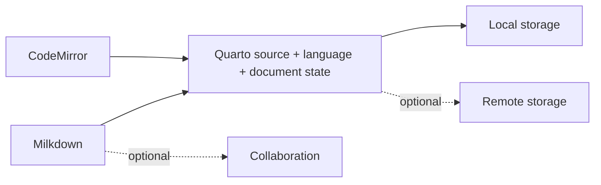

# Quartier

> **A home for your research.**

Quartier is a collaborative, web-based editor for Quarto documents. It combines the power of markdown editing with real-time collaboration, making it easy to work on research papers, reports, and documentation.

## Documentation

### Core Documentation
- **[Architecture & System Design](docs/ARCHITECTURE.md)**: Visual overview of the local-first core and optional editor, storage, and collaboration integrations.
- **[Build Profiles](docs/BUILD_PROFILES.md)**: Diagnostic builds for testing major features in isolation.
- **[KV Schema](docs/KV_SCHEMA.md)**: Database structure for sessions, tokens, and verification.
- **[Contributing](docs/CONTRIBUTING.md)**: Development setup and deployment guide.

### Additional Resources
- **[API Documentation](docs/API.md)**: Complete API reference with endpoints, request/response formats, and examples.
- **[Environment Variables](docs/ENVIRONMENT.md)**: Configuration guide for all environment variables and deployment settings.
- **[Security Best Practices](docs/SECURITY.md)**: Security guidelines, authentication, authorization, and incident response.

## Features

- **Markdown & Quarto Editor**: WYSIWYG editor with full markdown support.
- **GitHub Integration**:
  - File CRUD and Branch Management
  - Direct Commits from the browser
  - Repository browsing
- **Real-time Collaboration**:
  - **Host Mode**: Full GitHub access for repository owners.
  - **Guest Mode**: Secure, session-based access for collaborators via Cloudflare Access (Google/email compatible).
  - Live cursor and selection tracking.
- **Command Palette**: Quick access to actions with `Ctrl+K` / `Cmd+K`.

## Tech Stack

- **Frontend**: Vue 3 + TypeScript + Vite
- **Editor**: Milkdown (WYSIWYG) + CodeMirror (Source)
- **Backend**: Cloudflare Pages Functions
- **Database**: Cloudflare KV (Sessions/Cache)
- **Auth**: GitHub OAuth + Cloudflare Access

## Getting Started

See [CONTRIBUTING.md](docs/CONTRIBUTING.md) for detailed setup instructions.

```bash
# Install dependencies
bun install

# Start development server
bun run dev

# Build for production
bun run build
```

## Architecture

Quartier keeps Quarto intelligence and document state independent from editor engines, storage providers, and collaboration transports.



Development builds can exclude CodeMirror, Milkdown, remote storage, or collaboration to reveal accidental coupling:

```bash
npm run build:source-only
npm run build:visual-only
npm run build:local-writer
```

See [Architecture](docs/ARCHITECTURE.md) and [Build Profiles](docs/BUILD_PROFILES.md).

## License

MIT
