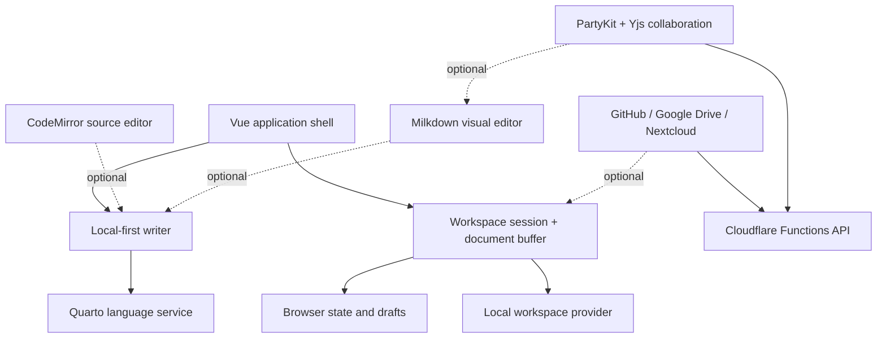
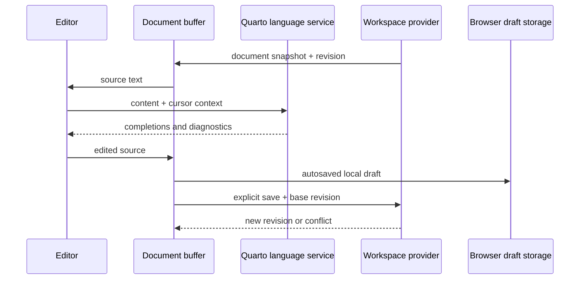
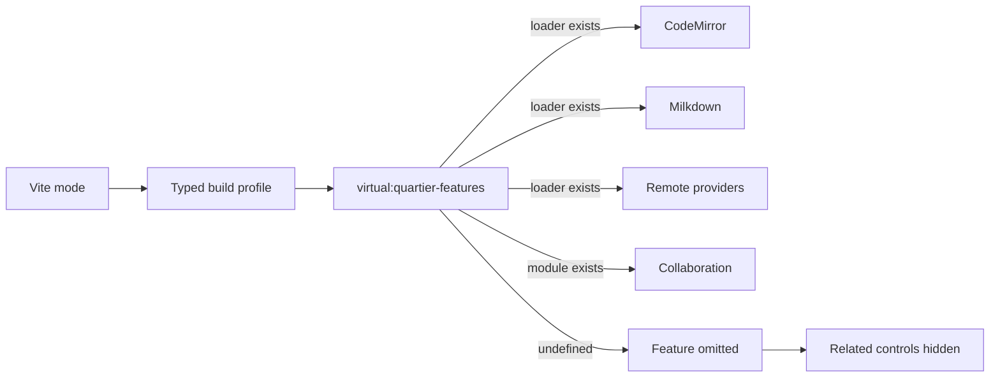
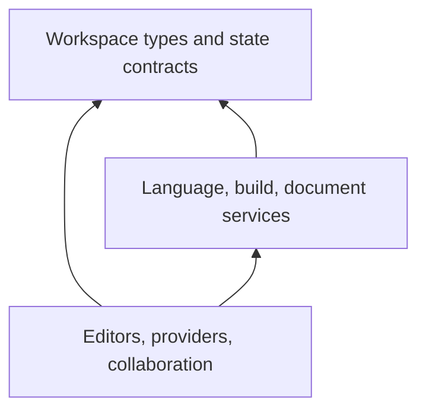

# Quartier Architecture

Quartier is a local-first Quarto authoring application with optional source editing, visual editing, remote storage, and collaboration. The architecture keeps the document model and Quarto intelligence independent from those optional integrations.

## System Overview



The solid path is the baseline application. Dashed modules can be excluded at build time without replacing them with fake implementations.

## Core Data Flow



The `.qmd` source is authoritative. Editors are views over the same source, and storage providers communicate through the `WorkspaceProvider` interface.

## Main Boundaries

| Boundary | Responsibility | Key location |
| --- | --- | --- |
| Application shell | Routes, layout, feature visibility | `src/router`, `src/components/layout` |
| Writer | Offline single-document authoring flow | `src/components/writer` |
| Editors | Source and visual editing surfaces | `src/components/editor` |
| Quarto intelligence | Completions, diagnostics, symbols | `src/core/language` |
| Workspace | Provider-neutral files and sessions | `src/core/workspace` |
| Document state | Drafts, dirty state, revisions | `src/core/state`, `src/composables` |
| Storage | Local and optional remote providers | `src/services/providers` |
| Collaboration | Optional Yjs/PartyKit binding | `src/composables/useCollab.ts` |
| Backend | Authenticated GitHub/session APIs | `functions/api` |

## Build-Time Composition

Quartier uses one small Vite virtual module, `virtual:quartier-features`, as its build boundary.



Application code follows a direct optional-capability pattern:

```ts
if (loadRemoteStorage) {
  const remoteStorage = await loadRemoteStorage()
  remoteStorage.registerRemoteStorage()
}
```

There are no disabled adapters, plugin registry, runtime feature toggles, or no-op lifecycle objects. If a loader or module is absent, the feature is unavailable and its implementation is not imported into the bundle.

See [BUILD_PROFILES.md](BUILD_PROFILES.md) for commands and the profile matrix.

## Dependency Direction



Core types must not import Vue components, editor engines, cloud SDKs, or collaboration transports. Optional integrations may depend on core contracts, never the reverse.

## Adding an Optional Feature

Use the existing pattern only when a dependency should genuinely disappear from diagnostic builds:

1. Keep the feature behind a focused entrypoint.
2. Add its import to `createVirtualFeatureModule`.
3. Export `undefined` when disabled.
4. Check for the optional capability at the nearest composition boundary.
5. Hide related controls and routes.
6. Add a profile test proving the disabled import is absent.

Ordinary Quarto behavior, UI components, and internal helpers should remain normal code rather than becoming configurable modules.
